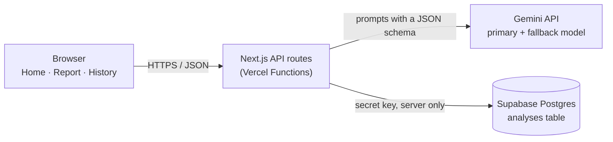

# Resume Screening Assistant

A web app for HR that compares a resume with a job description and returns a match score from 0 to 100, the top matching skills, the main gaps and three suggested interview questions. Every analysis is saved to a History page that can be filtered by score and searched by candidate name.

## Setup steps

### Requirements

- **Node.js 24** or later. The PDF extraction library requires it. On older versions `npm ci` prints an "unsupported engine" warning.
- **A Gemini API key** from [Google AI Studio](https://aistudio.google.com/) (the free tier is enough).
- **A Supabase project** (the free plan is enough).

### 1. Install

```bash
git clone https://github.com/syberPawn/resumeScreenerAssistant.git
cd resumeScreenerAssistant
npm ci
```

### 2. Create the database

1. Create a new project in [Supabase](https://supabase.com/).
2. Open the **SQL Editor**, paste the contents of [`supabase/migrations/0001_create_analyses.sql`](supabase/migrations/0001_create_analyses.sql) and run it. It creates the `analyses` table, its indexes and the name search function, and turns on Row Level Security.
3. Copy two values for the next step:
   - the **project URL**, from the project's **Connect** dialog;
   - a **secret key** (`sb_secret_...`), from **Settings → API Keys**. If the project has none yet, create one there.

### 3. Configure

Copy `.env.example` to `.env.local` and fill in the six values:

| Variable | Value |
|---|---|
| `GEMINI_API_KEY` | Your Gemini API key |
| `GEMINI_PRIMARY_MODEL` | `gemini-3.5-flash-lite` (already filled in) |
| `GEMINI_FALLBACK_MODEL` | `gemini-2.5-flash` (already filled in) |
| `SUPABASE_URL` | The project URL from step 2 |
| `SUPABASE_SECRET_KEY` | The secret key from step 2 |
| `PROFILE_SIGNING_SECRET` | A random value. Generate one with `node -e "console.log(require('crypto').randomBytes(32).toString('hex'))"` |

All six are read only on the server. `.env.local` is ignored by Git, so the keys are never committed.

### 4. Run

```bash
npm run dev
```

Open http://localhost:3000. Paste or upload a job description and a resume, click **Done** for typed text, then click **Analyse**.

### 5. Run the tests (optional)

No API keys or database are needed: Gemini and Supabase are replaced by test doubles, and the browser tests block any request that leaves `localhost`.

```bash
npm test                          # 70 unit and API tests
npx playwright install chromium   # once, downloads the test browser
npm run test:e2e                  # builds the app and runs 10 browser tests
```

### 6. Deploy to Vercel

1. In Vercel, import the GitHub repository. It is detected as a Next.js project.
2. Add the same six environment variables in the project settings.
3. Deploy.

Tip: for the fastest responses, set the Vercel function region (**Settings → Functions**) to the same region as the Supabase project.

## Architecture overview



The browser only talks to my own API routes. It never calls Gemini or the database directly, so the API keys never leave the server.

### How one analysis works

1. **Input.** Each panel takes typed text or an uploaded file, never both. An uploaded `.pdf` or `.docx` goes to `POST /api/extract`, which checks its real type from its first bytes, rejects files over 4 MB or 10 pages, extracts the text in memory and returns it. The file is never stored. Typed and extracted text pass the same checks: length limits, minimum word counts and a readable-text check.
2. **Profile first.** Clicking **Analyse** sends both texts to `POST /api/profile`. The server checks them again, and the first Gemini call confirms that they really are a resume and a job description and extracts the candidate's details. An email or phone number is kept only if it appears in the resume. The server signs the profile together with both texts (HMAC-SHA256), and the browser shows the profile card.
3. **Report.** The browser immediately sends the texts, the profile and its signature to `POST /api/analyses`. The server verifies the signature, makes the second Gemini call with a fixed scoring rubric, validates the result and saves it. The page address changes to `/analyses/{id}`, so a reload brings the report back.

### API routes

| Route | Purpose |
|---|---|
| `POST /api/extract` | Read one uploaded file and return its text |
| `POST /api/profile` | Check both texts, extract and sign the candidate profile |
| `POST /api/analyses` | Verify the signature, generate the report, save the analysis |
| `GET /api/analyses` | History list, with score range, name search and paging |
| `DELETE /api/analyses` | Delete all history (requires `{ "confirm": "delete-all" }`) |
| `GET /api/analyses/{id}` | One saved analysis |
| `DELETE /api/analyses/{id}` | Delete one saved analysis |
| `GET /api/candidates/suggest` | Candidate names for the History search box |

### Data model

One table, `analyses`, with one row per completed analysis:

| Column | Type | Notes |
|---|---|---|
| `id` | uuid | Primary key, used in the report address |
| `created_at` | timestamptz | Newest first in History |
| `candidate_name` | text | Trigram index for search and autocomplete |
| `profile` | jsonb | Current role, years of experience, location, email, phone |
| `job_title` | text | Taken from the job description, if it has one |
| `job_description` | text | What the candidate was scored against |
| `match_score` | smallint | 0 to 100, indexed for the score ranges |
| `report` | jsonb | Matching skills, gaps, interview questions |
| `model_used` | text | Which Gemini model produced the result |

### Code layout

| Path | Contents |
|---|---|
| `src/app/` | Pages (Home, History, saved report) and the API routes under `api/` |
| `src/components/` | Page components |
| `src/lib/` | Rules shared by browser and server: limits, messages, text checks, Zod schemas |
| `src/lib/client/` | Browser code: panel state, API calls |
| `src/lib/server/` | Server code: Gemini, Supabase, signing, text extraction, prompts |
| `supabase/migrations/` | Database setup |
| `tests/`, `e2e/` | Unit and API tests (Vitest), browser tests (Playwright) |

## Design decisions

**1. One Next.js project instead of a separate backend.**
The pages and the API routes live in one codebase and deploy together to Vercel, and the server routes keep every key off the browser.
*Trade-off:* the server code runs as serverless functions with time limits, so long work such as PDF parsing runs with a timeout.

**2. Two Gemini calls, profile first, instead of one streamed response.**
The first call is small, so the profile card appears while the report is still being generated, without streaming code on either end.
*Trade-off:* one extra round trip and one extra AI call per analysis.

**3. Structured output, validated on the server.**
Both calls use Gemini's structured output with a JSON schema, and every response is checked with Zod before it is shown or saved. Small deviations are tidied (a list cut to its maximum, "5+" read as 5); anything else, such as a score outside 0 to 100, cut-off JSON or a safety block, counts as a failure.
*Trade-off:* a strict check sometimes fails a response a person could have used, but nothing malformed ever reaches the database.

**4. A fixed scoring rubric and untrusted input.**
The report prompt scores with a fixed rubric (required skills 50, experience 30, preferred skills 10, education 10) and tells the model not to use name, gender, age, religion, nationality, ethnicity or similar details. Resume and job description text is wrapped in tags and treated as data, so instructions hidden in a resume cannot change the task. I kept the default temperature, as Google advises for Gemini 3 models, and rely on the rubric for consistency.
*Trade-off:* prompt injection can be reduced but not fully prevented, and the same inputs can still give slightly different scores.

**5. One fallback model, used only when retrying can help.**
If the primary model returns a rate limit error, a server error or a timeout, the call is retried once on the fallback model. Other errors fail straight away with a clear message. Model names are environment variables, so a retired model can be replaced without a code change.
*Trade-off:* the fallback (`gemini-2.5-flash`) is scheduled by Google to route to the primary model from December 2026, so that setting needs updating before then.

**6. A signed profile.**
The browser sends the profile back to the server for saving, so the server signs it together with both texts. A request with an edited profile or different texts is rejected, which means nobody can save a made-up candidate by calling the API directly.
*Trade-off:* one more secret to manage. The alternative, extracting the profile again when saving, would cost an extra AI call and could produce a card different from the one HR already saw.

**7. Uploaded files are never stored.**
Files are read in memory, turned into text and discarded. Only the job description, profile and report are saved, which keeps less personal data.
*Trade-off:* the original resume cannot be reopened from History.

**8. One table with JSONB and a trigram index.**
Each analysis is self-contained, and there is no reliable way to tell whether two resumes belong to the same person, so one `analyses` table fits. Fields that are searched or filtered get their own columns; the rest is JSONB. A trigram index makes name search and autocomplete fast.
*Trade-off:* the same candidate analysed twice appears as two History entries.

**9. Oversized input is rejected, not cut.**
Files are limited to 4 MB and 10 pages, resumes to 20,000 characters and job descriptions to 10,000. Cutting a resume to fit would quietly analyse only part of it and give a wrong score. Checks run cheapest first, both in the browser and again on the server, and each failure has its own message stating the number against the limit and what to do next.
*Trade-off:* unusually long CVs must be shortened first.

**10. One input source per panel.**
While a panel has typed text, its upload is unavailable, and while it has a file, its text box is locked. Each panel holds a single state value that decides which controls work, so the analysed input is never ambiguous. Unavailable controls use `aria-disabled` and explain why, so keyboard and screen reader users get the same information.
*Trade-off:* switching from typing to uploading takes one extra click to clear the text.

**11. Database locked to the server.**
Row Level Security is on with no policies, and the search function can only be called by the server's role, so Supabase's public API cannot read or change any data. Queries use the Supabase query builder, never strings built from user input.

**12. Demo scope.**
This is a demo, so it runs on free tiers and has no login: anyone with the link can use it and see History. On the Gemini free tier Google may use the submitted text to improve its products, so I test it with sample resumes only. Moving beyond a demo would need sign-in and paid tiers.
